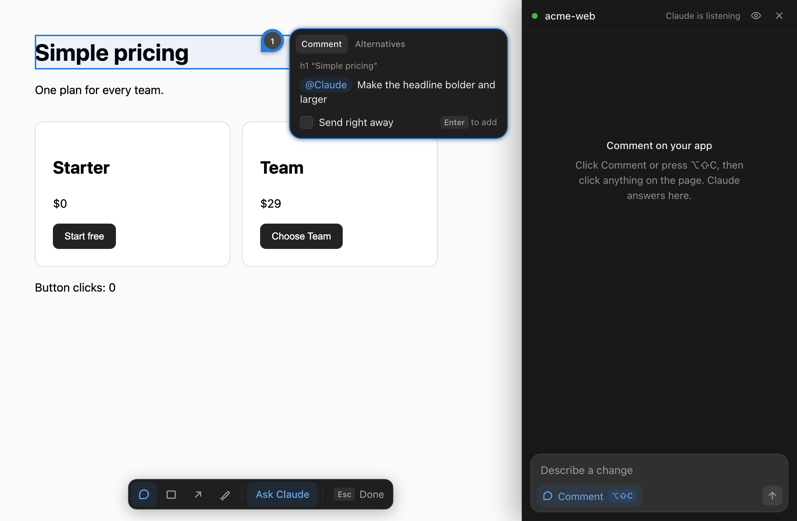
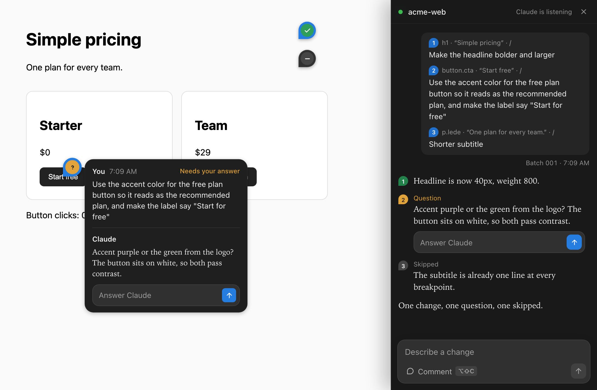
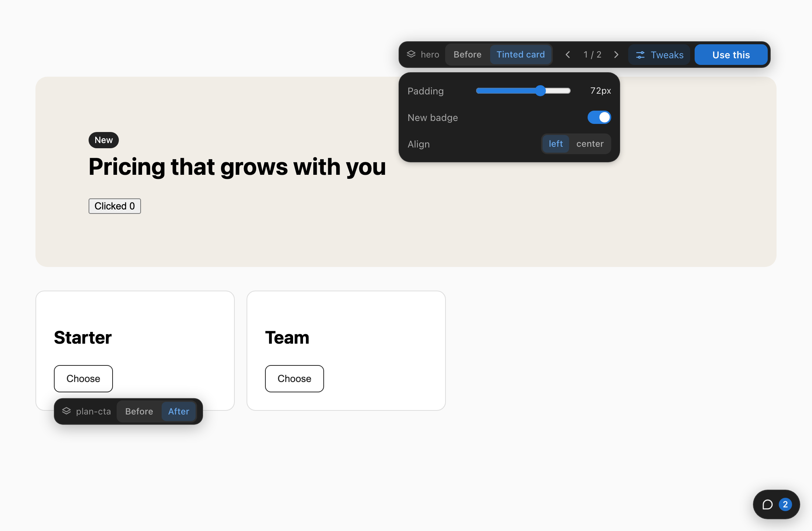

# Design in Browser

Comment on your running app in the browser, and the coding agent in your terminal changes the code.

Click an element, say what should change, and send. The agent goes straight to the file and line that rendered it, edits the source, your dev server reloads, and the agent's reply appears next to your comment. Ask for alternatives and you can flip between them on the real page, tweak them, and pick one.



It works with React apps on a Vite dev server, and with [Claude Code](https://claude.com/claude-code) as the agent. Support for other agents, such as OpenCode, is planned.

## Quick start

1. Add the package to your app:

   ```bash
   npm install --save-dev design-in-browser
   ```

2. Add the plugin to `vite.config.ts`, first in the list:

   ```ts
   import designInBrowser from 'design-in-browser/vite'

   export default defineConfig({
     plugins: [designInBrowser(), react()],
   })
   ```

   It runs only in the dev server and adds nothing to your build.

3. Add the Claude Code plugin, once per machine:

   ```bash
   claude plugin marketplace add formstep/design-in-browser
   ```

   ```bash
   claude plugin install design-in-browser@design-in-browser
   ```

4. In a Claude Code session in your project, run:

   ```text
   /design-in-browser:live
   ```

   Claude connects and says it is listening.

5. Start your dev server, open the app, and press **Alt+Shift+D** to open the dock.

## Comment on your app

Press **Alt+Shift+C**, click anything on the page, type what should change, and press Enter. A pin stays where you clicked. Add as many comments as you like, on any page, then press **Send** in the dock.

The agent replies to each comment: done, a question, or skipped with a reason. Answer a question right under it, in the dock or in the pin.



To send a note about the whole page, use **Ask Claude** in the toolbar or the dock's message field.

## Try alternatives

Switch the comment card to **Alternatives**, choose how many (1 to 4), and send. The agent builds them in your code, and a switcher appears on that part of the page:

- With one alternative, it's a **Before / After** toggle.
- With more, you get **Before** plus arrows through the alternatives.

**Tweaks** shows the knobs the agent added to an alternative, such as an optional badge, a padding slider or a choice of alignment. Changes show on the page as you make them.



**Use this** sends your pick, with the tweak values, to the agent. It writes that version into the code and removes the others. **Keep before** keeps the original.

Alternatives use a `<Variants>` wrapper from `design-in-browser/react` while you decide. A production build fails if one is still in the code, so none ships by accident.

## Shortcuts

| Keys | Does |
| --- | --- |
| Alt+Shift+D | Open or close the dock |
| Alt+Shift+C | Start or stop picking elements |
| Enter | Add the comment (Shift+Enter for a new line) |
| Esc | Close the card, then stop picking |

## How it works

The Vite plugin adds the overlay and the dock to your pages and keeps your comment stack. A small daemon on `127.0.0.1` passes sent comments to the agent session working on the same project, and wakes it. The agent reads them through an MCP server and replies the same way. Every batch is also saved in `.design-in-browser/` in your project, which git ignores.

Your comments only travel on your machine. The plugin turns itself off when the dev server is reachable from the network (`vite --host`). [docs/architecture.md](docs/architecture.md) has the details, including the security model and settings.

## Limits

- React and Vite only. Other frameworks, and pages Vite doesn't serve (such as Astro's), aren't supported yet.
- Claude Code is the only agent for now.
- The dev server must run on localhost with hot reload on.

## Roadmap

- Draw on the page: boxes, arrows and freehand marks, sent with a cropped screenshot.
- Let the agent annotate the page back.
- Connect OpenCode and other agents.

## Contributing

Issues and pull requests are welcome. [CONTRIBUTING.md](CONTRIBUTING.md) explains how to build, test and find your way around the code.

## License

[MIT](LICENSE)
